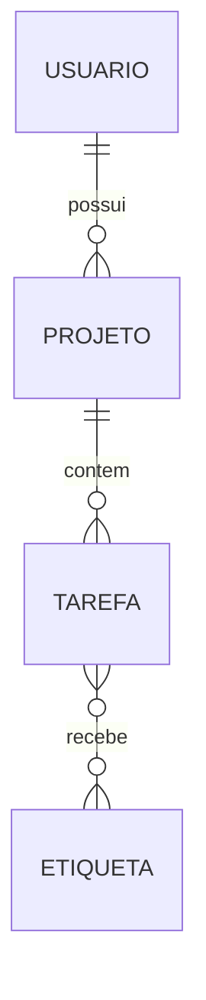

# Aula 2 — Modelagem entidade-relacionamento

**Duração:** ~25 min · **Módulo 10**

## Objetivo
Representar um domínio com entidades, atributos e relacionamentos e convertê-lo em tabelas.

## Teoria
- **Entidade**: objeto do domínio (Usuário, Projeto, Tarefa). **Atributo**: propriedade (título, data).
- **Relacionamento** e **cardinalidade**: 1:1, 1:N, N:N.
- Conversão para o modelo relacional:
  - 1:N → FK no lado "N".
  - N:N → **tabela associativa** com duas FKs (e PK composta).
  - 1:1 → FK com `UNIQUE`.
- Escolha uma **chave primária** estável (surrogate `id` ou chave natural).
- Etapas: **conceitual** (entidades) → **lógico** (tabelas e chaves) → **físico** (tipos e índices do SGBD).
- Ferramentas: dbdiagram.io, draw.io, Mermaid.

## Exemplo
Um usuário tem vários projetos; cada projeto tem várias tarefas; tarefas podem ter várias etiquetas.

```sql
CREATE TABLE usuarios (id SERIAL PRIMARY KEY, nome TEXT NOT NULL);

CREATE TABLE projetos (
  id         SERIAL PRIMARY KEY,
  usuario_id INT NOT NULL REFERENCES usuarios(id),
  nome       TEXT NOT NULL
);

CREATE TABLE tarefas (
  id         SERIAL PRIMARY KEY,
  projeto_id INT NOT NULL REFERENCES projetos(id),
  titulo     TEXT NOT NULL,
  concluida  BOOLEAN NOT NULL DEFAULT FALSE
);

CREATE TABLE etiquetas (id SERIAL PRIMARY KEY, nome TEXT UNIQUE NOT NULL);

CREATE TABLE tarefa_etiqueta (
  tarefa_id   INT REFERENCES tarefas(id),
  etiqueta_id INT REFERENCES etiquetas(id),
  PRIMARY KEY (tarefa_id, etiqueta_id)
);
```

## Exercício
1. Modele uma biblioteca (livros, autores, empréstimos, leitores) e identifique as cardinalidades.
2. Desenhe o diagrama ER em Mermaid ou dbdiagram.io.
3. Converta para `CREATE TABLE` com PKs e FKs.

## Checklist
- [ ] Identifico entidades, atributos e cardinalidades
- [ ] Sei resolver N:N com tabela associativa
- [ ] Converto o modelo ER em tabelas
