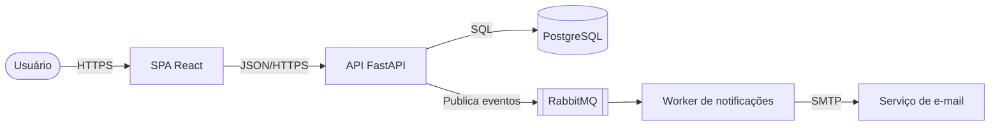

# Aula 9 — Documentação de arquitetura (C4, ADRs)

**Duração:** ~20 min · **Módulo 16**

## Objetivo
Documentar a arquitetura com diagramas C4 e registrar decisões em ADRs.

## Teoria
- **Modelo C4** (Simon Brown): quatro níveis de zoom.
  1. **Contexto**: o sistema, seus usuários e sistemas externos.
  2. **Contêineres**: aplicações/dados executáveis (SPA, API, banco, fila).
  3. **Componentes**: partes internas de um contêiner.
  4. **Código**: classes (raramente necessário; gere automaticamente).
- Setas rotuladas com a tecnologia/propósito ("HTTPS/JSON"). Todo elemento tem nome, tipo e descrição.
- **ADR** (Architecture Decision Record): documento curto, versionado no repositório (`docs/adr/0001-titulo.md`), um por decisão. Campos: Título, Status (proposto/aceito/substituído), Contexto, Decisão, Consequências. ADRs aceitos **não são editados**: criam-se novos que os substituem.
- Documentação como código: Mermaid, PlantUML ou Structurizr, versionados com o código.
- Documente **o porquê**, não só o quê; mantenha enxuto e atualizado.

## Exemplo: diagrama de contêineres (Mermaid)


## Exemplo: ADR
```markdown
# ADR 0003 — Usar PostgreSQL como banco principal

- **Status:** Aceito (2026-03-10)
- **Contexto:** Precisamos de transações ACID e consultas relacionais para tarefas e projetos. A equipe conhece SQL.
- **Decisão:** Adotar PostgreSQL 16, acessado via SQLAlchemy.
- **Alternativas:** MongoDB (flexível, sem joins fortes); SQLite (não atende concorrência em produção).
- **Consequências:** (+) integridade e ferramentas maduras; (−) escala de escrita horizontal exige mais trabalho; custo de operar o banco.
```

## Exercício
1. Desenhe os níveis Contexto e Contêineres do sistema de tarefas em Mermaid.
2. Escreva 3 ADRs (ex.: arquitetura hexagonal, banco, autenticação) em `docs/adr/`.
3. Revise um ADR de um colega: o contexto justifica a decisão?

## Checklist
- [ ] Desenho os níveis 1 e 2 do C4
- [ ] Escrevo ADRs com contexto, decisão e consequências
- [ ] Versiono a documentação junto ao código
